---

### 👨‍💻 About Me

Software engineer exploring the intersection of **Generative AI, Agentic AI, and software engineering.**

Currently at **Tata Technologies**, working on AI-powered enterprise solutions and intelligent automation.

Interested in building reliable AI systems, understanding how things work under the hood, and turning complex ideas into practical solutions.

---

### 🚀 Shipped Products

Side projects that left the laptop: built, deployed, and available to anyone.

<table>
<tr>
<td width="50%" valign="top">

#### 🏝️ Isle
**A floating pill that shows what Claude Code is doing, and lets you approve its permission requests with one click.**

No more alt-tabbing to the terminal every time an agent asks *"can I run this?"*

- 👀 Live view of Claude Code's current activity
- ✅ One-click **Allow / Deny**. Answer in Isle or the terminal, first answer wins
- 🔒 Never auto-approves anything. No answer in 60s → Claude asks in the terminal
- 🔌 One-click **Connect** to wire up the hooks, no Node.js needed
- 🛡️ Local only. Nothing about you or your work is uploaded

`Windows 10+` · `macOS 12+ (Apple silicon & Intel)` · `Private beta`

</td>
<td width="50%" valign="top">

#### 🪝 HookVault
**A Chrome extension for creators: swipe file, outlier finder and AI repurposer.**

Find what works, save it, turn it into posts.

- 💾 **Save** hooks, titles and posts from YouTube and X into one searchable library
- 📈 **Spot outliers**: videos beating a channel's median views by 3x+ get a badge
- ✍️ **Repurpose** a video or any text into an X thread, LinkedIn post, Shorts titles, hooks, descriptions or captions
- 🔑 Bring your own AI key (Anthropic, OpenAI-compatible, or local Ollama)

`Chrome (Manifest V3)` · `Cloudflare Workers + D1` · `Freemium`

</td>
</tr>
</table>

---

### ⚡ Tech Stack

`LLMs` · `AI Agents` · `RAG` · `LangChain` · `Langfuse` · `Hugging Face` · `Ollama` · `Claude Code Hooks` · `Chrome Extensions (MV3)` · `Cloudflare Workers`

### 📡 GitHub Activity

---

💡 *Build things that matter. Understand what you build.*

